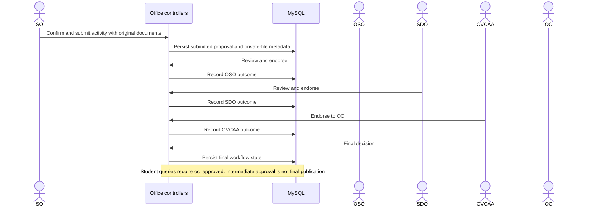
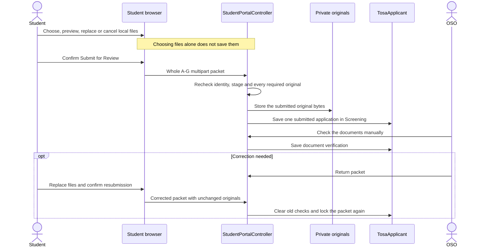

# End-to-End Data Flow

These are current subsystem boundaries. Detailed validation and return/rejection rules belong to the linked workflow notes, not to a historical three-node demonstration sequence.

## Activity approval and visibility

Returned/rejected paths are described in [[Activity Proposal Approval Pipeline]].

## Student TOSA packet

See [[TOSA Application and Review Workflow]]. OSO checks the uploaded documents manually; OrgChain does not calculate scores or rankings.

## Financial evidence and voting proofs

Receipt metadata/originals, balances and anchor state are separate concerns. Do not call an expense node-confirmed solely because an upload succeeded. Public expense summaries require the implemented review/chain gates; originals remain authorized. See [[Budget Utilization and OCR Receipts]] and [[Expense Review and Financial Liquidation Flow]].

Voting uses the configured driver, eligibility/session checks and persisted ballot/receipt records. The recorded pilot uses Besu; the old three-node JSONL sequence describes only the file-driver mode. Chain verification must distinguish historical proofs, current-network verification, failure and unavailable verification. See [[Blockchain Architecture - Complete]] and [[Receipt Verification and Audit]].

Source: current project README, `StudentPortalController`, `OfficePortalController`, `OrgActivity::visibleToStudents()`, `config/besu.php` and the dedicated workflow services.
