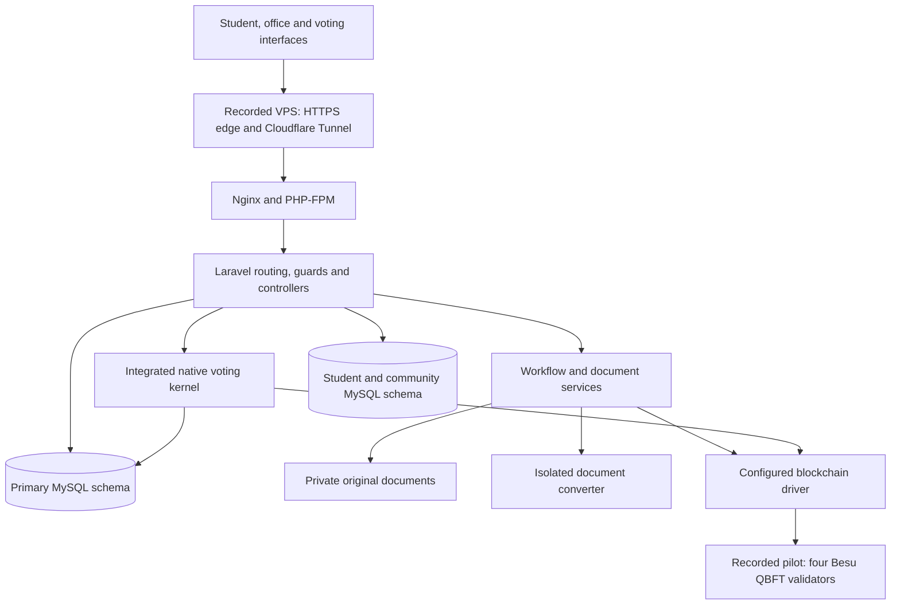

# High-Level Technical Architecture

OrgChain is a modular monolith, not a collection of independently deployed business microservices. Blade/JavaScript interfaces call Laravel controllers; the voting module is mounted inside the application through `App\VotingSystem\Kernel`.

## Boundaries

- **Laravel portals:** `routes/web.php`, `app/Http/Controllers/`, `resources/views/org/` and `resources/views/portal/`. `student` and `office` guards have separate identities and authorization.
- **Voting:** `routes/voting.php`, `app/VotingSystem/Kernel.php` and its controllers/router. Native voting CSRF/session rules are not interchangeable with portal authentication.
- **Relational data:** `mysql` and `orgchain` connections. Cross-schema application relationships may lack physical foreign keys; [[Database Schema and ERD]] labels that distinction.
- **Evidence:** uploaded originals remain off-chain. Authorized routes stream private files; public asset prefixes are explicitly limited. See [[Security Architecture and Guardrails]].
- **Conversion:** legacy Word preview uses an isolated converter; failure must not fabricate a document or overwrite the original.
- **Ledger:** `config/besu.php` selects the driver. File/JSONL operation is an explicit alternate mode; a failed Besu call must not be relabeled as a successful file-ledger transaction.
- **Readiness:** `routes/health.php` serves allowlisted cached states outside the web/session middleware. Private scheduled observations do the probing; public HTTP reads do not trigger probes.

The four validators share one VPS in the recorded pilot, so a VPS outage can affect all of them. This is not multi-host high availability. See [[VPS Pilot Deployment and Status]] for deployment scope, not the older multi-laptop demonstration runbook.

Source: `bootstrap/app.php`, `config/database.php`, `config/besu.php`, `app/VotingSystem/Kernel.php`, `infra/vps/` and project README.
