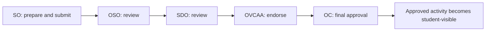

# System Overview and Institutional Vision

OrgChain supports student-organization governance at Batangas State University: activity proposals, budget/expense accountability, organization renewal, semester reports, TOSA applications and elections.

## Purpose and limits

- Route submissions through the responsible offices and show the recorded review state.
- Keep organization funds, activity budgets and expense evidence attributable to the correct organization.
- Let authorized users inspect original documents without publishing confidential uploads.
- Anchor supported voting/expense proofs for later integrity verification; blockchain is not document storage or a substitute for the relational database.
- Provide student-facing activities, official announcements, feedback and an audience-scoped community feed.

These are implemented capabilities and design goals, not measured claims of faster approvals, complete transparency or impossible tampering. No outcome percentage or turnaround improvement is asserted without evaluation evidence.

## Activity approval responsibility

An adviser/dean signature or organization-information field does not create an additional login role. Returned/rejected transitions and document permissions remain workflow-specific; see [[Activity Proposal Approval Pipeline]].

## Current technical direction

The application is a Laravel modular monolith with an integrated native PHP voting kernel, two configured MySQL schemas and private document storage. The last recorded VPS deployment uses a four-validator Besu QBFT network. The historical three-node file driver is a different configured mode, not the current Besu topology or automatic failover.

See [[High-Level Technical Architecture]], [[Database Schema and ERD]], [[TOSA Application and Review Workflow]] and [[VPS Pilot Deployment and Status]].

Source: project `README.md`, `routes/web.php`, `app/Models/OrgActivity.php`, `config/besu.php` and `infra/vps/`.
