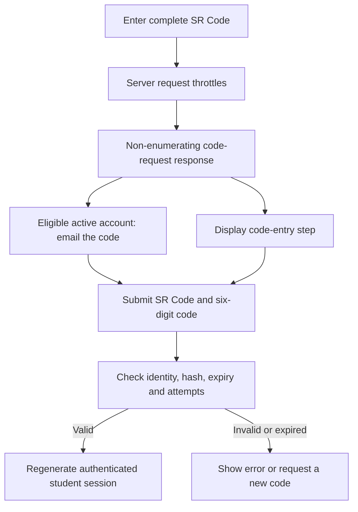

# Student Email Verification Code

The SR Code and verification code are different inputs. Enter the full SR Code such as `YY-XXXXX`; the next step accepts the six-digit code delivered to the registered institutional mailbox.

`StudentAuthController` stores a password hash, expiry and failed-attempt state, not a plaintext code. The current expiry is 10 minutes; five wrong attempts clear the pending code. Named route throttles add request/verification protection. Do not copy threshold assumptions from native voting SecurityGuard into this flow.

Active and unknown SR Codes have indistinguishable request responses. The UI opening the next step is not proof that an account exists or that mail was delivered. Invalid verification preserves the intended code-entry UI rather than requiring a second Login click.

There is no supported response/session/cache debug field exposing the code to a browser test. Use the authorized institutional mailbox; old `EXPOSE_TEST_OTP` instructions are obsolete. Do not record actual codes in notes or screenshots.

Source: `StudentAuthController`, student login routes and the landing login view. See [[Student Profile and Authentication]], [[Session Management and Lifetime Policies]] and [[Testing and Quality Assurance Guide]].
