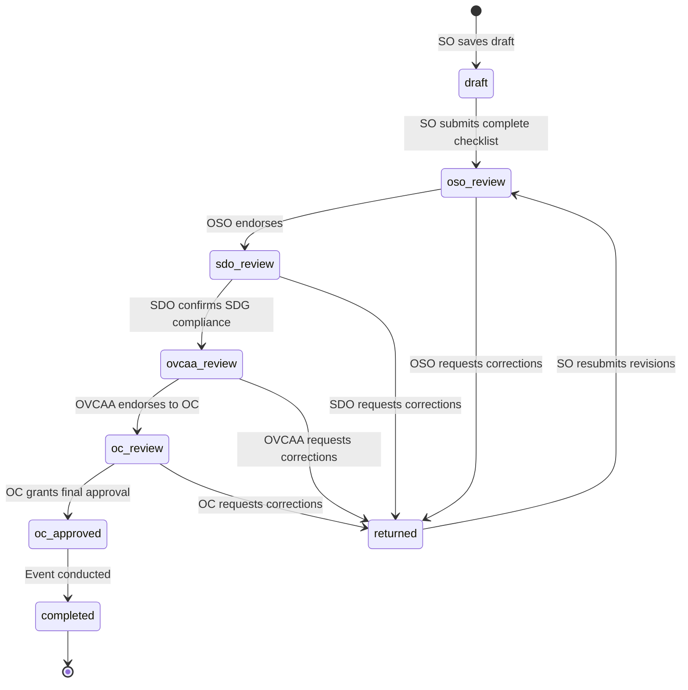

# 📝 Activity Proposal Approval Pipeline

> [!info] Approval Pipeline
> Activity submissions use `app/Models/InCampusActivitySubmission.php` and their linked `OrgActivity` records. SO organization ownership and the persisted review stage govern changes; a visible button does not grant permission.

---

## 🔄 State Machine & Status Progression

New SO submissions go directly to OSO. `college_review` remains supported for legacy records and optional college-reviewer endorsements.

---

## 📄 Proposal Document Attachments (JSON Payload)

The `InCampusActivitySubmission` stores all compliance documents within a structured `attachments` JSON column:
1. **Checklist Template**: Completed compliance items.
2. **Project Proposal**: Objectives, background, target audience.
3. **Detailed Programme**: Hourly schedule and speaker roster.
4. **Itemized Budget Proposal**: Allocation requests and financial sources.
5. **Faculty-In-Charge Assignment**: Signed departmental adviser endorsement.
6. **Medical & Insurance Request Letters**: Health protocol and student insurance coverage.
7. **Organization Board Resolution**: Official officer approval minutes.
8. **Waste Policy Compliance Form**: Solid waste management plan.

---

## 🧭 Current Filing Experience (2026-09-20)

The activity form now supports both filing types from the same route:

- `in_campus` — BatStateU in-campus activity requirements.
- `local_off_campus` — local off-campus / CHED compliance requirements.

The selected type changes the visible checklist, official template links, document pack and conditional questions. Select an activity from the organization's approved Attachment I: its title/reference are derived from that approved plan entry rather than typed independently. Allocated budget is required but may be ₱0; the server validates the submitted amount.

### Checklist submission behavior

Submitted activities are locked until returned; ended proposals cannot advance. OSO and SDO explicitly confirm document review. Every reviewing desk, including OVCAA and OC, validates the latest submitted packet and each required readable, non-empty private file inside the approval transaction. A complete older version cannot replace missing current evidence. Final OC approval also enforces the existing funding rules; a complete ₱0 proposal remains valid.

1. **Save draft** stores the activity and any uploaded files already selected without requiring the final checklist files.
2. **Submit for review** validates the required pre-activity uploads for the selected type.
3. The current official checklists require all ten in-campus files or all nine local off-campus files; the selected activity type determines the required slots.
4. Missing, draft, unreadable or empty evidence blocks endorsement/final approval before workflow events, plan-verification metadata or budget reservations are written. Historical approval records are retained and visibly flag unavailable evidence instead of inventing documents or silently resetting approval.
5. Submitted checklist rows are persisted in `activity_compliance_docs` with `pending` review status.

### Official document workflow

The form keeps the official In-Campus and Local Off-Campus templates as file-backed documents. Supported DOCX files can be previewed in the browser; the original file remains the explicit download path. Students complete the official file externally and upload the signed or completed version through the checklist before final submission.

The OSO Updates page uses the same source-backed approach. Its official-template cards now resolve to the supplied files in `In Campus/`, `Local Off Campus/`, `TOSA/`, and `Reports/`, with the file size and modified date read from disk at request time. Legacy demo cards and generated placeholder downloads are no longer used. Legacy `.doc` sources remain downloadable as-is; the supplied WPCF PDF render is used only for its in-page preview.

### OSO document visibility rule (2026-09-21)

The stored attachment is the source of truth: an orphan compliance-status row is not proof of an uploaded document. Review resolves the compliance row's owning submission and actual saved file, including retained earlier versions where applicable. Current uploads use private `local` storage, and authorized preview/download routes enforce role, organization and submission ownership before serving the original. Do not infer a public URL from a stored path.

Related: [[Multi-Tier Office Roles SO OSO SDO OVCAA]], [[Office Portal API and Action Endpoints]] and [[VPS Pilot Deployment and Status]]. Current source: `OfficePortalController`, the activity form and attachment routes in `routes/web.php`. Dated session logs preserve earlier behavior and storage assumptions.
