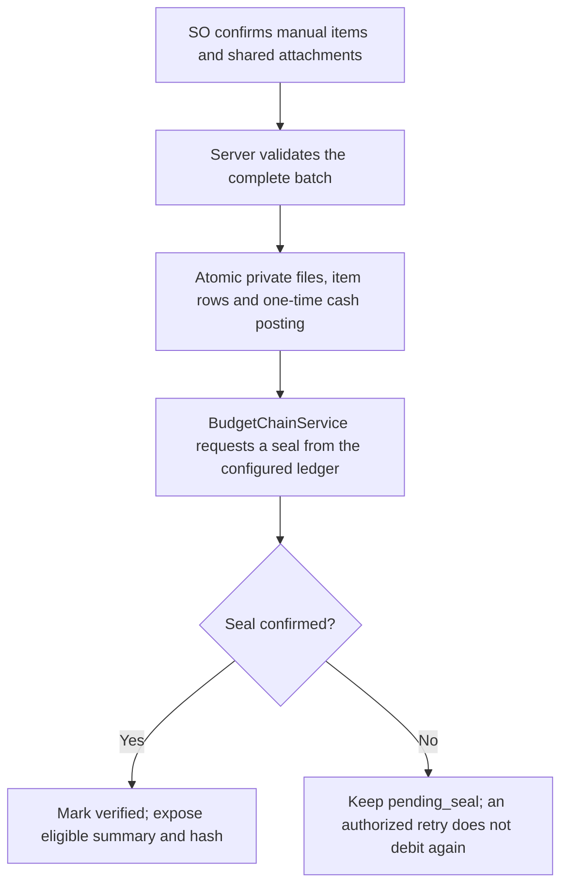

# 💰 Budget Utilization & Receipt Records

> [!important] Standard receipt workflow
> The SO Budget Utilization form is manual and direct: officers upload receipt and invoice attachments (image or PDF), enter the purchase details (merchant, item, unit cost, date, reference number), and submit. OCR scanning is not used in this project per project requirements.

> [!important] Current activity and account scope
> Final-approved activities are the authoritative allocation/spending ledger. New receipts are activity-ID linked and private; pending seals already count as recorded expenses but are not shown publicly as confirmed. Approval reserves funds; receipts debit cash once. SO accounts are bound to their assigned organization, not a shared cross-organization desk. Historical [[Session Log 2026-09-21 Activity Budget Lifecycle]] remains a session record, not the current account-isolation specification.

> [!tip] Current receipt entry behavior
> Summary cards and visible charts precede **Record Expense**. Select an approved activity, choose up to three shared receipts, enter up to 20 item cards, then confirm **Record expense** once. **Add item / Remove / Clear** change the local batch. Server validation, exact quantity × unit-cost totals, transactional writes, one-time cash posting and receipt seals remain authoritative; a failed batch does not record partial items or balances.

OSO sees the real organization cash/approved-budget directory with live search and five-row paging. Search filters rows without changing consolidated totals. **View Details** opens an organization-only activity dialog, then an activity's actual spending, approved budget, signed balance, payment methods, categories and searchable items. Receipt viewing stays private/read-only and returns to that activity; closing details restores directory focus.

AR and FR are independent of expense entry and of one another: each submitted report locks immediately, and only its return for revision reopens editing. See [[Semester AR and FR Submission Workflow]]; this does not rename report or receipt verification.

> [!abstract] Financial Accountability
> OrgChain records itemized receipt photos, manually entered expense details, server-side budget deductions, and blockchain seals for accountable student-fee utilization.

---

## 🧾 Expense Liquidation & Manual Receipt Recording

---

## Legacy budget category entity

`BudgetItem` retains title/category/allocated/utilized/fiscal-year fields for older category records. These are not a second allocation source for the current student scope breakdown: [[Transparency and Budget Visibility]] uses approved activity allocations and actual spending, with compact In-Campus/Off-Campus rows.

---

## 🔍 Receipt review fields and legacy scan metadata

> The active manual flow intentionally leaves OCR confidence, scan IDs, and OCR corrections empty. These columns remain in the database only so older scanner-generated records and compatibility endpoints can still be read safely.

Source: `app/Models/ExpenseReceiptReview.php`. Legacy scan-related fields are not evidence that the active manual flow performs OCR:
- `activity_title`: Event associated with the expense.
- `item_name`: Purchased item or service.
- `unit_cost`: Manually entered unit cost; the server calculates quantity × unit cost.
- `ocr_confidence`: Text recognition certainty percentage (0-100%).
- `student_confirmed`: Boolean flag confirming student officer verified the parsed data.
- `verification_status`: `pending_seal` immediately after the atomic batch write, then `verified` after node consensus; `approved` is retained only for legacy rows.

## 🧾 Shared receipt upload and itemized entry

- The active SO form uploads one shared receipt/supporting-document set (`receipts[]`, maximum three files) before the item list. It previews each selected file locally and supports JPG, PNG, WebP, and PDF attachments up to 5 MB each.
- The first item row and every **Add item** row contain manual fields only. A receipt containing many purchases is handled by adding one input row per item; the same uploaded receipt set is reused for every row.
- The final server-side `recordMany()` call stores one `ExpenseReceiptReview` per item row and one quantity × unit-cost debit per row. Shared files are stored once and de-duplicated in receipt history and ZIP exports.
- The active path does not scan or classify the uploaded file. OCR/DOCX compatibility code is only reachable when an older client explicitly provides `receipt_scan_id`.
- Receipt history, financial compilation, ZIP export, and the blockchain seal remain itemized because each manual row is stored as its own receipt record.

---

## Configured ledger versus legacy file-driver layout

The recorded VPS pilot selects Besu and runs four QBFT validators on the same host; see [[VPS Pilot Deployment and Status]]. Office reviewer roles are not a one-to-one map of validator processes, and failed consensus is not a successful file-ledger fallback.

The separate file-driver/legacy setup uses `storage/app/orgchain/budget/node-{1,2,3}/budget.jsonl`. This is a configured demonstration mode, not the recorded VPS's current ledger topology.

Receipt records preserve seal metadata such as `chain_hash`, `previous_hash` and `nodes_confirmed`. Only a confirmed seal changes a pending row to `verified`; eligible summaries can then appear in [[Transparency and Budget Visibility]]. Neither blockchain mode verifies the paper receipt's authenticity.

Related: [[Organization Renewal Filing Window]] (separate org recognition flow)

---

## Live activity budget data and viewing

`OfficePortalController::buildLiveBudgetDataset()` reads final `oc_approved` activities, eligible itemized receipts and workflow events within office organization/department scope.

- Activity allocations use `approved_budget`; item spending uses quantity × unit cost. Earlier recorded activity spending is retained as its own explanatory chart category, never fabricated receipt rows.
- SO uses its assigned organization's approved-activity selector and current academic-year/semester scope. OSO retains consolidated monitoring and organization/activity drill-downs.
- Zero approved budget is **N/A** utilization in OSO details. Overspending retains its negative balance and percentage above 100%; only the visual progress bar saturates.
- The In-Campus/Off-Campus expense split sums actual activity spending, not sample legacy category amounts.
- Only SO records/retries receipts. Office roles do not manually approve receipt rows; blockchain seal status remains `pending_seal` / `verified` (with historical `approved` rows retained).
- `GET /office-desk/budget-utilization/receipts/{review}/view` is SO/OSO-only and organization-checked; `attachment={index}` selects a shared file and `download=1` preserves the original. Missing files return 404, not demo evidence.
- Receipt selection/preview is local and unprompted. Final recording confirms once; cancelling preserves the chosen files and manual item cards without posting.

## 🧹 Receipt upload state safety (2026-09-21)

- The SO receipt form now clears a photo and preview restored by a browser reload or back/forward cache. A restored browser file is not treated as a new user upload.
- The upload status and submit state return to **No receipt selected** until the SO chooses the photo again.
- This is client-side lifecycle protection; it does not delete any stored receipt record.

## 🔎 Manual receipt photo guidance (2026-09-21)

- Upload a clear, complete receipt photo showing the purchase information needed for the manual fields.
- The form checks the selected photo type and size before submission; it does not interpret the image or claim that the receipt is authentic.
- Receipt type and payment method may remain unknown when the paper receipt does not print them; the SO can select the appropriate value manually.

## 📅 Approved activity period alignment (2026-09-21)

- The SO Budget Utilization selector is now limited to final-approved activities in the selected academic year/semester.
- The default activity is selected from that same period. A July 2026 activity is treated as A.Y. 2025–2026 Midyear, not A.Y. 2026–2027.
- Opening a deep link for an activity from another academic year redirects to that activity's correct annual period instead of showing a false zero-budget/no-matching-records state.

## 🖼️ Shared receipts with many item rows (2026-09-21)

- The shared uploader accepts up to three receipt/supporting-document files and shows a thumbnail or PDF card for each one, with individual removal before submit.
- If one receipt lists ten purchased items, upload it once and add ten manual item rows. Every row points to the same stored attachment set, so the SO does not have to re-upload or duplicate the receipt.
- `expense_receipt_reviews.receipt_attachments` stores the private-file manifest while `receipt_path` and `receipt_name` remain compatibility fields. The authenticated view, Receipt History, and ZIP register expose the files and every item mapping.

## Related and source evidence

[[Transparency and Budget Visibility]] · [[Semester AR and FR Submission Workflow]] · [[Office Portal API and Action Endpoints]] · [[Web and Portal Route Map]]

Current README; `OfficePortalController::buildLiveBudgetDataset()` / `viewReceipt()` / `storeReceiptReview()`; `resources/views/org/budget.blade.php`; activity budget/cash ledger services. Historical session logs are preserved.
