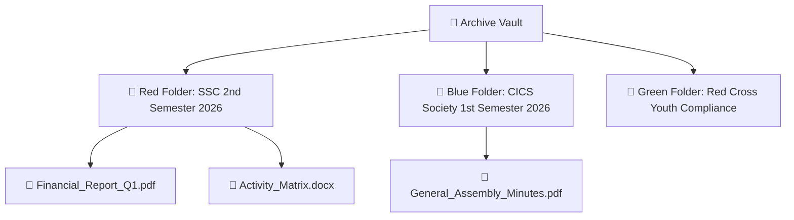

# 📂 Document Archive & Compliance Repository

> [!abstract] Digital Document Vault
> The OrgChain Archive module (`/office-desk/archive`) provides a multi-semester document management system organized by student organization, semester, and color-coded folders.

---

## 🗂️ Folder & Document Architecture

---

## Storage, explicit saving and report boundaries

- SO can access only its assigned organization's folders/documents/activity files; OSO retains cross-organization Archive access.
- Create a folder, choose **Upload Document**, select its folder and a completed DOCX, then confirm **Upload & Archive**. Selecting a file alone does not upload/save; cancelling confirmation preserves the local selection.
- New manual uploads use the private `local` disk (`archive/{folder_id}/...`), up to 20 MB. DOCX content is validated. `archive_documents` retains `original_name`, file metadata and `file_disk`; do not assume all older records use the same disk.
- Authenticated, ownership-checked `/office-desk/archive/documents/{document}/view` and `/download` serve actual document bytes. Equivalent `/archive/activity-documents/{document}/view` and `/download` routes serve activity documents.
- Centered document previews use the actual Word/PDF content; downloads retain original filenames/bytes. Read-only preview/download and local file choice do not prompt.
- OSO's searchable organization cards support year/college filters and pagination. **Open archive** groups preserved reports, approved renewals, activity documents and other files, including nested folders rather than only recent-file lists. Source folder/activity/renewal period identifies each file.
- Manual archiving does not submit or decide an AR/FR. [[Semester AR and FR Submission Workflow]] archives each report independently after OSO verification/acceptance; AR and FR do not need to be accepted as a pair.

Related: [[Office Portal API and Action Endpoints]] · [[Web and Portal Route Map]] · [[Organization Renewal Filing Window]]

Source: current README; `OfficePortalController::storeArchiveFolder()` / `storeArchiveDocument()` and authenticated archive access methods; `routes/web.php`.
