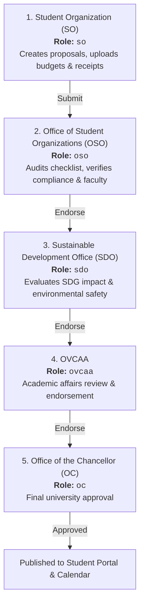

# 🏛️ Multi-Tier Office Roles (SO, OSO, SDO, OVCAA, OC)

> [!abstract] Governance Hierarchy
> The OrgChain Administrative Desk (`/office-desk`) is structured around BatStateU's staged institutional review chain for student organizations. OVCAA reviews and endorses; the Office of the Chancellor (OC) records final approval.

---

## 👥 The Administrative Desks

---

## 📋 Role Responsibilities Matrix

| Office Role | Code | Primary Responsibilities | Can Approve Stages |
| :--- | :--- | :--- | :--- |
| **Student Organization** | `so` | Draft proposals, manage members, prepare and submit AR and FR independently for the assigned organization, record expense receipts | Draft submissions and report preparation |
| **Office of Student Orgs** | `oso` | Verify institutional checklist, audit faculty-in-charge assignments, review activities, decide each AR/FR independently, acknowledge/dismiss student feedback, publish notices | Activity endorsement; individual report return/reject/verification and archival |
| **Sustainable Dev Office** | `sdo` | Audit environmental compliance, waste management policies, and UN SDG mappings | Activity SDG review only |
| **OVCAA Review Desk** | `ovcaa` | Review SDO-verified packages and endorse the complete activity record to OC | OVCAA review only |
| **Office of the Chancellor** | `oc` | Review the complete activity package and record the final university decision | Final activity approval only |

---

## 🎨 Role-Based Branding & Context Badges

Each office user sees tailored navigation headers and badge counters generated by `OfficePortalController::deskContext()`:
- **Brand Title & Seal**: Automatically tailored to the officer's specific department.
- **Semester report navigation**: Financial Report and Accomplishment Report are rendered only for `so` and `oso`.
- **SDO / OVCAA / OC boundary**: These desks do not receive AR/FR badges or dashboard report metrics, and direct report page/file requests return `403`.
- **OSO-only review**: AR and FR have independent submission/review locks and decisions. Acceptance verifies and archives only the selected report; a returned report alone reopens for SO revision. See [[Semester AR and FR Submission Workflow]].

## Other scoped desk actions

- **Submission windows:** OSO locks/reopens AR or FR separately for the selected year/semester across all organizations. Locking uses the dedicated period/scope dialog; reopening confirms too. Neither control changes another report type or unlocks a report already under review.
- **Feedback:** OSO uses **Acknowledge report** / **Dismiss**, retaining the historical feedback `verified` persistence names. Only the submitting student receives acknowledgment history/notifications; this wording does not rename receipt/report verification. See [[Transparency and Budget Visibility]].
- **Notices:** OSO publishes; office readers can persist their own timestamped **Acknowledge Notice** receipt and copy a deep link. The receipt is account-specific, not a campus-wide acknowledgment.
- **TOSA:** OSO has Master clearance; OVCAA is read-only unless assigned Evaluator clearance (capped at Level 2). SO/SDO/OC have no TOSA access. Review/scoring require Level 2+, and reference replacement remains OSO-only. See [[TOSA Application and Review Workflow]].
- **Confirmation boundaries:** business changes require confirmation without duplicating dedicated dialogs. File choice/replacement/cancellation, navigation, previews and downloads are unprompted. Logo/template selections remain local until explicit confirmed upload/save.

Routes: [[Office Portal API and Action Endpoints]] · [[Web and Portal Route Map]]. Source: `OfficeUser::tosaClearanceLevel()`, office controller role guards, report services, shared action confirmations and current README.
