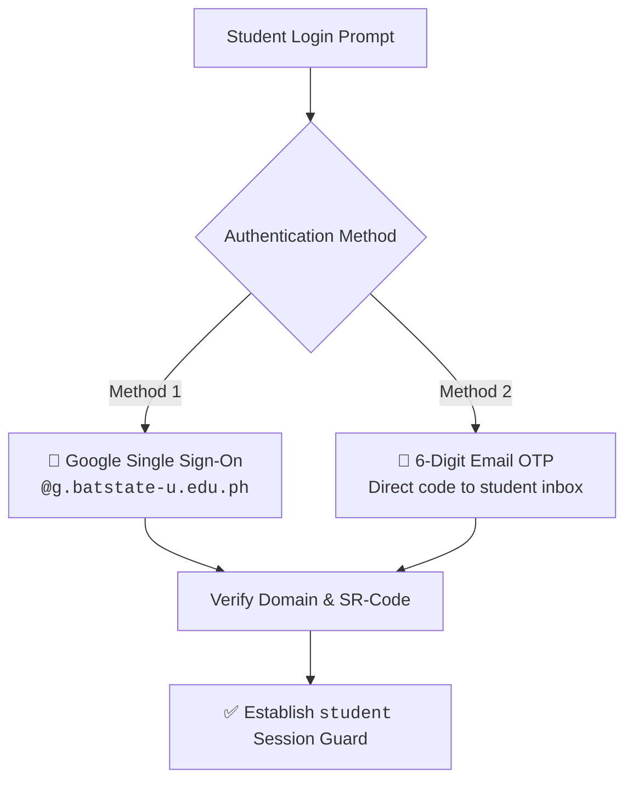

# 👤 Student Profile & Authentication

> [!abstract] Student Identity
> In OrgChain, students sign in using their full university **SR Code** and institutional email verification or the authorized university Google Workspace account (`@g.batstate-u.edu.ph`).

---

## Student identity and profile settings

The student guard uses `App\Models\UserAccount` on the `orgchain` connection. Its persisted primary key is `user_id`; `sr_code` identifies the student's university record and owns the TOSA packet. Current identity fields include:
- `sr_code`: University student identification string.
- `full_name`: Full student name.
- `email`: Institutional email address.
- `college`: Academic college (e.g., *College of Informatics and Computing Sciences*).
- `program`: Degree program (e.g., *BS Information Technology*).
- `year_level`: Student year level (for example, *4th Year*), not the reporting academic year.
- `account_status`: Account state; `UserAccount::isActive()` requires `active`.

Profile settings displays official name, college and year level as read-only fields, with **Close** only and no Save changes/Cancel form. `PUT /portal/profile` rejects editing with 403 and directs corrections to the registrar. The unused **Compact view** toggle is removed; it is not a supported setting.

Related: [[Transparency and Budget Visibility]] · [[Community Feed Posts and Likes]] · [[TOSA Application and Review Workflow]] · [[Web and Portal Route Map]]. Source: current README, `StudentPortalController::updateProfile()` and portal layout.

---

## 🔐 Dual Authentication Pathways

