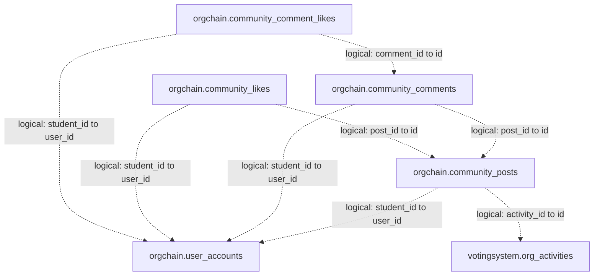
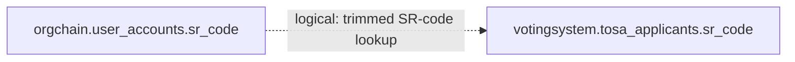

# Application Relationships and Schema Boundaries

Related: [[Database Schema and ERD]] · [[Eloquent and Core Models Reference]]

> [!important] Logical does not mean database-enforced
> All arrows and relationship rows in this note describe **current source-defined links**, unless explicitly identified as physical. They supplement, not replace, the unchanged [[ERD Exports/orgchain-local-erd.dbml|local physical DBML]] and [[ERD Exports/orgchain-local-schema.sql|local schema-only SQL]]. An absent FK does not establish that a table is unused, nor does a matching `_id` name prove its target.

The `mysql` connection is associated with `votingsystem` in this local snapshot; `orgchain` is the separate configured connection used by `UserAccount` and community models. Configuration can change database names. These diagrams do not claim live production schema coverage or data integrity.

## Community is not the legacy students graph

`CommunityPost`, `CommunityComment`, `CommunityLike` and `CommunityCommentLike` explicitly use the **`orgchain` connection**. Their `student()` relationships explicitly target **`UserAccount` with owner key `user_id`**. `UserAccount::id` is an accessor for `user_id`, so controller writes of `$student->id` do not mean `students.id`.

### Current logical community map

Every arrow below is **logical/application-defined**, not an additional physical FK. Arrows point from child/lookup to target. Database prefixes are deliberately visible.

| Confirmed link | Source evidence | Boundary |
| --- | --- | --- |
| All four `orgchain.community_* .student_id → orgchain.user_accounts.user_id` | Each community model's `student()`; `UserAccount::posts/comments/likes`; `CommunityFeedController::store/comment/like/likeComment` writes the authenticated student's identifier | No corresponding declared local FK; do not redirect these links to legacy `students` |
| `orgchain.community_comments.post_id → orgchain.community_posts.id` | `CommunityComment::post()`, `CommunityPost::comments()`; comment creation | No declared local FK |
| `orgchain.community_likes.post_id → orgchain.community_posts.id` | `CommunityLike::post()`, `CommunityPost::likes()`; post reaction writes | One stored reaction per post/student pair is supported by the local unique index; it is not seven separate like models |
| `orgchain.community_comment_likes.comment_id → orgchain.community_comments.id` | `CommunityCommentLike::comment()`, `CommunityComment::likes()`; comment-like writes | Local unique index is `(comment_id, student_id)`; no FK |
| `orgchain.community_posts.activity_id → votingsystem.org_activities.id` | `CommunityPost::activity()`, `OrgActivity::posts()`; post creation validates `activity_id` against `org_activities` | Optional cross-connection relationship, not a declared cross-database FK |

`community_likes.reaction` persists the seven controller-supported codes: `like`, `love`, `care`, `haha`, `wow`, `sad`, `angry`. Repeating the same reaction removes it; choosing another changes the stored reaction. Comment likes are a separate toggle, not the same seven-code reaction system. Feed queries use relation counts and visibility-scoped search; legacy count columns alone are not the authoritative relationship map.

### Why the physical export looks different

The local **`votingsystem.community_posts`, `community_comments` and `community_likes`** tables still declare FKs to **`votingsystem.students.id`**. Their comment/post and activity FKs are also real local constraints. They must remain visible in the physical DBML, but they are **not the tables selected by the current community models**. Both graphs can exist in one export without either being an accurate substitute for the other.

Source evidence: `app/Models/CommunityPost.php`, `CommunityComment.php`, `CommunityLike.php`, `CommunityCommentLike.php`, `UserAccount.php`, `OrgActivity.php`; `app/Http/Controllers/CommunityFeedController.php`; `StudentPortalController::portal` feed query. The local DBML's database-qualified table definitions and `Ref` section independently establish the physical side.

## Feedback and activity registration use current student identity

| Confirmed logical link | Evidence | Physical local status |
| --- | --- | --- |
| `votingsystem.student_feedback.student_id → orgchain.user_accounts.user_id` | `StudentFeedback::student()` explicitly specifies `UserAccount`, `student_id`, `user_id`; `StudentPortalController::storeFeedback()` saves the authenticated identifier | Nullable column and a named index, **no declared FK**. The index name ending `_foreign` is not a constraint |
| `votingsystem.activity_registrations.student_id → orgchain.user_accounts.user_id` | `StudentPortalController::toggleRsvp()` reads/writes `student_id` from the student guard and stores SR-code/name/year snapshots; `config/auth.php` maps that guard to `UserAccount` | No student FK. The activity FK to `votingsystem.org_activities.id` **is physical** |

Feedback author/college fields and registration SR-code/name/year fields are stored snapshots, not separate joins inferred from their labels. Feedback's current `verified_*` fields support the acknowledgment workflow; their names do not turn them into physical reviewer FKs.

## TOSA uses an SR-code lookup, not a student-id relationship

- `StudentPortalController::myTosaApplication()` trims the authenticated student's SR code and selects the **first** matching `TosaApplicant` by `sr_code`.
- Whole-packet submission re-fetches/locks the `UserAccount` on `orgchain`, then finds/locks the applicant by SR code on `mysql`. It creates an applicant with identity snapshot fields if no applicant exists.
- There is no `student_id` relationship on `TosaApplicant`, no declared FK for SR code and no unique SR-code index in the exported local `tosa_applicants` definition. This lookup is **not a database-guaranteed one-to-one relationship**, and it is not a per-academic-year join just because applicants store an academic year.
- Identity fields such as name/email/college are copied on applicant creation, not proof of additional joins.
- Requirements and evaluator scoring are stored JSON/application state, not additional relationship tables. The local export lacks the newer `score_evaluation` column used by source. See [[Eloquent and Core Models Reference#TOSA stores a packet and evaluator state|packet, revision and scoring semantics]].

Evidence: `app/Models/TosaApplicant.php`, `app/Http/Controllers/StudentPortalController.php` (`myTosaApplication`, packet submission), `app/Services/TosaScoringService.php`; exported `tosa_applicants` indexes/columns.

## Activity accomplishments and semester packets

| Confirmed logical link | Evidence | Limitation |
| --- | --- | --- |
| `votingsystem.org_activity_accomplishments.org_activity_id → votingsystem.org_activities.id` | `OrgActivityAccomplishment::activity()`; `AccomplishmentReportService::save()` locks and checks organization ownership of the selected activity | Local unique `org_activity_id` index enforces at most one entry per activity, but **no FK** enforces existence or deletion behavior |
| `org_activity_accomplishments.created_by` / `updated_by → office_users.id` | `AccomplishmentReportService::save()` writes the authenticated `OfficeUser` ID, preserving the original creator and updating the editor | Controller/service-defined attribution, not model relationships or local FKs |
| Native accomplishment entries → a semester `OrgReportDocument` packet | `AccomplishmentReportService::entries/nativeDocument/save()` groups by organization name, semester and academic year, regenerates a DOCX and saves the packet in `accomplishment_summary` | A period-key/JSON association, **not** a direct accomplishment-to-document FK |

The actual `org_report_documents.org_report_status_id → org_report_statuses.id` link **is a physical local FK**. Do not invent an accomplishment-document join table or model. Activity/financial snapshots and evidence arrays preserve report content; evidence bytes and generated report files are stored privately. Uploaded completed AR documents are a separate supported path and need not have native accomplishment rows.

Evidence: `app/Models/OrgActivityAccomplishment.php`, `OrgReportDocument.php`; `app/Services/AccomplishmentReportService.php`; `app/Http/Controllers/AccomplishmentReportController.php`; current `README.md` accomplishment-report behavior.

## Deliberately not inferred

- No arrows are added merely for `uploaded_by`, `actor_id`, `reviewed_by`, `verified_by`, `recorded_by`, `org_id`, `tagged_users` or JSON fields. Some have verified meanings elsewhere, but a name alone is insufficient and names may be snapshots rather than IDs.
- Existing physical `orgchain` proposal/report/user-account relationships remain in the physical export even when they are outside the current office workflow. A physical FK establishes a constraint, not an active feature's implementation.
- Expected standalone infrastructure/configuration tables are listed in [[Database Schema and ERD#Isolated tables are not automatically missing relationships|the physical guide]].
- The newer `office_announcement_acknowledgments` table is not in these local attachments. Source/VPS behavior must not be drawn as an existing local table.
- This note records source intent and observed exported structure, not record-level integrity, successful migrations, runtime queries or production verification.
