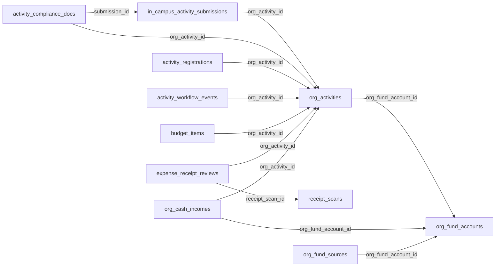
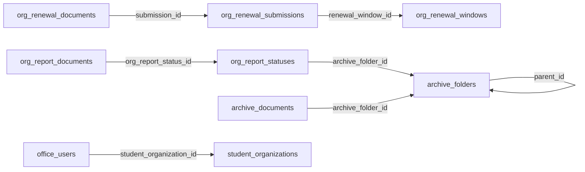

# Database Schema & Entity-Relationship Guide

> [!important] Local structure, not the live production database
> The attachments below describe the **local** `votingsystem` and `orgchain` databases extracted on **2026-10-15 at 09:07:46 UTC**. Together they contain **64 tables, 668 columns and 47 declared foreign-key constraints**. They contain no records, routines or triggers. Current application source and the deployed VPS can differ from this snapshot; do not treat it as a live production ERD or a migration plan.

## Start here

| Need | Open |
| --- | --- |
| Exact local table definitions, defaults, indexes and FK actions | [[ERD Exports/orgchain-local-schema.sql|Local schema-only SQL]] |
| All physical tables and database-declared relationships in an ERD editor | [[ERD Exports/orgchain-local-erd.dbml|Local physical ERD (DBML)]] |
| Current code-defined links, including cross-database student/community identity | [[Application Relationships and Schema Boundaries]] |
| Actual PHP models, connections, roles and stored-document semantics | [[Eloquent and Core Models Reference]] |
| Seed/demo context rather than current record contents | [[Database Seeders and Demo Fixtures]] |

The two attachments are copies of `storage/erd/orgchain-local-schema.sql` and `storage/erd/orgchain-local-erd.dbml` inside this vault's `03 - Database and Data Models/ERD Exports/` directory. Moving the vault does not require access to the repository's `storage/` directory. SQL and DBML are text attachments, not rendered Obsidian diagrams; open the DBML in a compatible **local/offline** editor to explore the complete physical graph. The focused diagrams below are readable directly in Obsidian. Uploading even structure-only files to an external diagram service is a separate disclosure decision.

## What a relationship line means

| Representation | Meaning | Does not mean |
| --- | --- | --- |
| SQL `CONSTRAINT … FOREIGN KEY … REFERENCES …` | A declared constraint in the exported local database; its `ON DELETE`/`ON UPDATE` clauses specify database actions | That the active application uses that table or connection |
| Every `Ref` line in `orgchain-local-erd.dbml` | One of those same **47 physical constraints**, with database-qualified endpoints | An inferred relationship from an `_id` name |
| SQL `KEY`/`UNIQUE KEY`, DBML `indexes`, or an `_id` column | Indexing/uniqueness or a column name | A foreign key by itself |
| An arrow explicitly labeled **logical** in [[Application Relationships and Schema Boundaries]] | A relationship verified in a model, controller or service | A database FK, automatic cascade, or proof that every stored row has a matching parent |

Keep the physical SQL/DBML unchanged. This guide intentionally does **not** offer one universal application ERD: merging legacy physical constraints with current logical links would make different schemas and identity systems look interchangeable. No application-overlay DBML is supplied; the separate relationship note carries those distinctions explicitly.

## Two database namespaces are significant

- **`votingsystem`** contains the local election tables and the office/activity/finance/renewal/reporting tables, plus legacy students/community tables and infrastructure. Models that explicitly use Laravel's `mysql` connection are described here against that local namespace.
- **`orgchain`** contains `user_accounts`, the community tables used by the current community models, and the older proposal/report/organization schema. `UserAccount` and all four current community models explicitly select the `orgchain` connection.
- These are **snapshot database names**, not universal connection guarantees. `config/database.php` makes the default connection, the `mysql` database and the `orgchain` database configurable. Some Eloquent models inherit the default connection. Check configuration when deploying; no credentials or environment values are included here.
- `votingsystem.student_organizations.id` and `orgchain.student_organizations.org_id` are different physical tables with different keys. Likewise, the same `community_*` table name exists in both databases. Always keep the database qualifier when discussing these tables.
- The student guard resolves **`App\Models\UserAccount` → `orgchain.user_accounts.user_id`**, not the legacy **`App\Models\Student` → `students.id`**. See [[Application Relationships and Schema Boundaries#Community is not the legacy students graph|the community identity distinction]].

## Focused physical diagrams

All edges in this section are **database-enforced FKs in the local export**. These are deliberately incomplete views; use the SQL for nullability, uniqueness and delete actions, rather than reading the arrows as a full cardinality specification.

### Activity filing and finance

Every table in this diagram is in **`votingsystem`**. Each label is the child column that references the parent `id`.

`org_activity_accomplishments.org_activity_id` is intentionally **not** an edge here: the local export has a unique index but no FK for it. The application relationship is documented separately. `activity_registrations.student_id` also has no declared local FK; its current write path uses the authenticated `UserAccount` identifier.

### Renewal, reports and archive

Every table in this diagram is in **`votingsystem`**.

Organization/semester/academic-year scoping and JSON document metadata are not extra foreign keys. Saving a file or native activity report does not itself submit a semester report to OSO.

### Election reading path

In `votingsystem`, the physical graph includes `positions.election_id → elections.id`, `candidates.position_id → positions.id`, and the `votes` FKs to elections, voters, positions and candidates. `vote_receipts` references elections and voters. `audit_logs.user_id` references `admin_users.id`. Read the physical DBML for the full graph; blockchain metadata is not an additional relational FK and this schema export contains neither ballot records nor on-chain state.

## Isolated tables are not automatically missing relationships

The physical ERD shows only declared constraints. An unconnected node can be expected infrastructure/configuration or a domain table joined only in code.

| Local table(s), all in `votingsystem` | Why a separate node is reasonable |
| --- | --- |
| `cache`, `cache_locks` | Key-based cache/lock storage; no declared domain FKs |
| `jobs`, `job_batches`, `failed_jobs` | Queue payloads and batch/failure bookkeeping; not a student/activity relationship graph |
| `migrations` | Migration ledger structure; this export does not include its records |
| `sessions`, `password_reset_tokens` | Session/reset infrastructure; an indexed `sessions.user_id` is not a declared FK or evidence of a specific guard's identity table |
| `rate_limit_hits`, `security_events` | Rate-limit/security event storage; absence of a parent FK is not evidence of a broken export |
| `office_settings`, `office_templates`, `org_report_submission_windows` | Scope/category/period-based configuration and submission controls |
| `office_announcements` | Announcement content; the newer acknowledgment table is absent from this local snapshot |
| `users` | Separate conventional Laravel account table; not the configured student provider |

Conversely, current `orgchain.community_*`, `votingsystem.student_feedback`, `votingsystem.tosa_applicants` and `votingsystem.org_activity_accomplishments` have verified application links despite missing physical relationship lines. Their absence from the physical graph must not be described as “unused” or repaired by inventing FKs. See [[Application Relationships and Schema Boundaries]].

## Known snapshot/source differences

These are documentation boundaries, not instructions to change the database:

1. **Announcement acknowledgment:** the current source includes `OfficeAnnouncementAcknowledgment` and its additive migration; the local export lacks `office_announcement_acknowledgments`. This table was deployed on the VPS according to the deployment context for this documentation update. Do not add it to this local physical ERD or claim the local snapshot describes the full VPS schema.
2. **TOSA scoring:** `TosaApplicant`, `TosaScoringController` and `TosaScoringService` use stored JSON `score_evaluation`; migration `2026_10_11_000001_add_score_evaluation_to_tosa_applicants.php` defines that addition. The exported local `tosa_applicants` definition does **not** contain this column. The model's cast is not evidence that the local snapshot has it.
3. **Migration completeness:** these exports are not a migration-completeness certificate. A source model, migration or newer changelog entry never silently updates the attached physical files. By contrast, `org_report_documents.financial_summary` and `accomplishment_summary` are already present in this local snapshot; their JSON contents are not exported.
4. **Private documents:** a schema default is not a storage policy. For example the local SQL still declares `archive_documents.file_disk` default `'public'`, while the current archive upload controller explicitly writes `'local'` and authenticated archive access requires that disk. Current activity, renewal, semester-report and TOSA submission files also use private local storage. See [[Eloquent and Core Models Reference#Files are metadata, not public URLs|the file-access reference]].

## Evidence and maintenance

- Physical evidence: the linked SQL (DDL, indexes, FK clauses) and DBML (database-qualified tables and `Ref` lines), originally exported from local databases on 2026-10-15.
- Current identity/connections: `config/auth.php`, `config/database.php`, `app/Models/UserAccount.php`, `Student.php`, `OfficeUser.php` and `Community*.php`.
- Logical links and current write behavior: source pointers in [[Application Relationships and Schema Boundaries]] and [[Eloquent and Core Models Reference]].
- Current behavior summaries: repository `README.md` and `CHANGELOG.md`. Historical session notes and older model notes are context, not a substitute for the qualified physical export or the current source.

For a future refresh, export structure only from the explicitly identified environment, retain namespace qualifiers, and document the extraction time and counts before replacing attachments. Do not import the SQL merely to view it: it includes database creation and table-creation statements. This documentation update does not apply migrations, inspect records or change local/live schemas.
