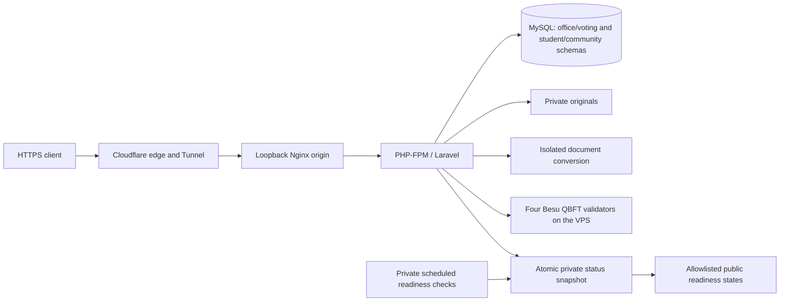

# VPS Pilot Deployment and Status

This is the last recorded deployment topology, documented from repository configuration and the 2026-10-15 release record. This vault update did not connect to or modify the website, VPS, services or databases. A recorded successful check is not a claim of current uptime.

## Recorded pilot topology

The recorded application release is `f260201`. Public pilot pages were released without the temporary operator-network allowlist; records still require authentication and role/owner/stage checks. The laptop is not the recorded public origin. The older [[Multi-Laptop 3-Node Blockchain Setup Runbook]] is an alternative demonstration topology, not this deployment.

Four validators on one VPS share a host failure domain. The pilot is not a four-machine availability design. Private RPC, signing material, tunnel credentials and internal diagnostics must not be published.

## Status surfaces

- Public site: <https://orgchain.tech>
- Independent status site: <https://status.orgchain.tech>
- Laravel request/render health: `/up` (not `/health`).
- Cached readiness index: `/health/services`.
- Per-component readiness: `/health/services/{service}` for `database`, `blockchain`, `private-storage`, `document-processing`, `institutional-sign-in` or `mail-provider`.

The public site and request-health checks plus six component checks make eight monitored surfaces. The private systemd timer schedules component observations every five minutes; stale/unknown results fail closed according to the configured snapshot policy. HTTP reads do not trigger the expensive/provider probes.

Provider readiness does not prove successful user login or delivery to every mailbox. Blockchain readiness does not prove every historical receipt belongs to the current network. No readiness check should send user mail, submit votes/transactions, read student evidence or migrate schemas.

## Change boundaries

Use backups and reviewed additive migrations, then deploy the matching code/assets and invalidate only affected runtime caches. The new announcement receipt table must exist before the updated office announcements page is served. A local schema export is not automatically at the deployed migration level; [[Application Relationships and Schema Boundaries]] records known snapshot differences.

Never redeploy `.env`, signing keys, populated dumps or local test fixtures as public assets. Keep existing originals, session/encryption keys and user records intact. Public storage rules must continue to deny confidential prefixes, including direct community-photo URLs. An authorized image route handles existing and new photos.

Source: `infra/vps/`, `routes/health.php`, `app/Services/Health/`, `config/system-health.php`, README and CHANGELOG. Current service state belongs on the status surfaces, not as a permanently green statement in this note.
